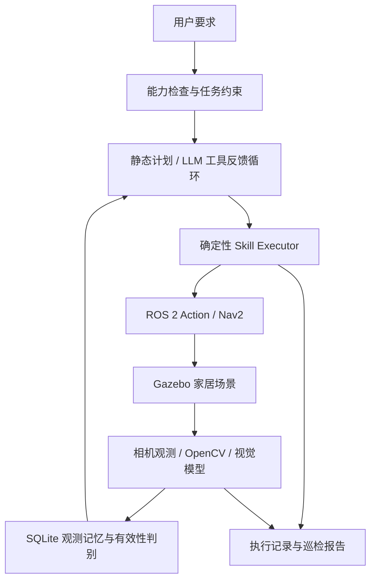

<!-- 用途：面向 GitHub 读者介绍 RoboPilot 的功能、架构、安装运行、实验结果与开发边界。 -->
# RoboPilot

**基于 ROS 2、视觉感知与地点级语义记忆的具身 Agent 自主巡检原型。**

机器人在 Gazebo 家居环境中前往指定观察点，检查物品及其状态，保存相机证据与观测历史，并返回任务起点。项目将 LLM 规划、受约束工具调用和实际机器人导航连接起来，支持可追溯的任务报告与重复实验。

技术栈：`ROS 2 Jazzy` · `Gazebo Harmonic` · `Nav2` · `Python / rclpy` · `DeepSeek` · `OpenCV` · `SQLite`

> 当前为仿真研究原型，尚未验证真机。执行流程已跑通，启动与视觉判断仍存在已记录的失败；具体指标见第 4 节。开发记录截至 2026-10-31。

## 1. 项目功能

### 家居多目标巡检

场景包含客厅、卧室、厨房与玄关；机器人采用酒店服务机器人外形，顶部安装 RGB 相机，使用差速底盘移动。

| 检查任务 | 检查内容 | 方法 |
|---|---|---|
| 客厅工具箱 | 当前观察视野中是否有工具箱 | 云端视觉模型 |
| 卧室背包 | 背包是否挂在墙钩上 | 云端视觉模型，关系判断 |
| 外门 | 指定外门是否关闭 | 云端视觉模型，状态判断 |
| 厨房果盘 | 指定观察点的果盘中是否有水果 | 云端视觉模型，条件判断 |
| 客厅红色标记 | 当前画面是否包含符合阈值的红色区域 | 本地 OpenCV |

用户可输入编号或受支持的中文要求，先查看执行计划，再确认开始。检查完成后返回本次起点。场景支持落地背包、开门、空盘、遮挡等变体，用于构造正反例。

### 三种任务入口

| 模式 | 工作方式 | 入口 |
|---|---|---|
| 自选检查 | 从能力清单选择目标，生成确定性巡检流程 | `./robopilot check` |
| 自然语言静态规划 | LLM 一次生成结构化计划，通过能力与完整性校验后执行 | `./robopilot task '中文指令'` |
| 工具反馈循环 | LLM 接收工具执行结果，再选择下一步；按给定地点顺序搜索，找到后返航 | `./robopilot search bedroom living_room` |

三种模式的能力范围不同。静态规划与工具循环尚未开放任意检查对象；新增家居状态检查请使用 `check` 或 `household`。

### 证据与记忆

- 每次到点后获取新图像，关联观测时间、地点和机器人位姿。
- 以 SQLite 保存任务与追加式观测历史，导出 JSON 和带图片的 Markdown 报告。
- 查询目标最近发现位置，区分历史线索与本次证据；后续否定或未知观测不会被旧肯定覆盖。
- 通过目标、后端、地点配置摘要、任务来源、有效期和证据引用判别记忆有效性。跨任务历史用于提供线索，当前巡检仍要求现场复查。

这里的空间记忆是**已知地图上的地点级观测记忆**，尚未实现开放世界三维语义建图。

## 2. 系统设计



LLM 负责选择任务级动作；执行器负责有限重试、依赖管理、超时和取消确认。机器人运动由 Nav2 完成，模型通过受约束的工具接口操作机器人。

工具循环包含 `list_places`、`query_memory`、`navigate_to`、`inspect_target`、`return_to_start` 和 `finish_task`，并设置轮数、时间和重复调用上限。无法判断时返回 `unknown`，不会自动等同于目标不存在。

**执行成功与检查条件满足分别记录。** 例如门未关闭时，检查本身可以完成，但条件不满足；相机受阻或识别不确定则记录为未知。`SUCCEEDED` 也不能替代人工真值核对后的端到端成功率。

```text
.
├── robopilot                   # 便捷命令：构建、仿真、巡检、规划与诊断
├── src/robopilot/
│   ├── robopilot/              # 规划、工具循环、执行器、感知、记忆与报告
│   ├── launch/                # Gazebo / Nav2 启动与运行配置
│   ├── config/                # 地点、别名和公开模型配置模板
│   ├── examples/              # 结构化任务及评测样本
│   └── tests/                 # 单元测试与 ROS 集成测试
├── scripts/                   # 家居任务评测与记忆消融实验
├── docs/                      # 操作、设计及实验方法
├── PROGRESS.md                # 开发过程、验证记录及后续工作
└── runs/                      # 本地运行结果，默认不提交 Git
```

## 3. 安装与运行

### 环境准备

已验证环境：Ubuntu 24.04 ARM64 虚拟机、ROS 2 Jazzy、Gazebo Harmonic，4 核 CPU、约 6 GiB 内存，使用 llvmpipe 软件渲染。相机配置为 320×240、2 Hz，以控制虚拟机负载。尚未对其他系统组合完成验证。

先安装与 Ubuntu 24.04 匹配的 ROS 2 Jazzy，并确保 `/opt/ros/jazzy/setup.bash` 存在。以下命令在 **Linux 虚拟机内**执行；macOS 宿主机不直接运行该 ROS 工作区。

```bash
# 安装构建工具与依赖管理器（已安装可跳过）
sudo apt update
sudo apt install python3-colcon-common-extensions python3-rosdep python3-pytest

# 将 GitHub 仓库克隆到本机，然后进入包含本 README 的项目根目录。
source /opt/ros/jazzy/setup.bash

# 首次使用 rosdep 时执行一次；已经初始化则跳过 init。
sudo rosdep init
rosdep update
rosdep install --from-paths src --ignore-src -r -y --rosdistro jazzy

./robopilot build
```

依赖由 ROS 包的 `package.xml` 声明，包括 Nav2、最小 TurtleBot3 仿真、图像桥接、OpenCV、NumPy 和 YAML。模型客户端使用 Python 标准库 HTTP 接口，无需安装 OpenAI SDK。

### 第一步：启动仿真

终端 1，在项目根目录运行：

```bash
./robopilot sim-lite
```

该命令启动家居世界、Gazebo 窗口和导航栈，初始化新世界的机器人定位；省略 RViz 以减小负载。需要 RViz 时使用 `./robopilot sim`。等待启动诊断输出 `ready: true`。

终端 2，同样进入项目根目录：

```bash
./robopilot doctor
./robopilot inspect
```

`inspect` 执行客厅→卧室→返回起点的本地红色标记巡检，**不需要 API 密钥**，也不会启动仿真。两个终端的 ROS 域配置应保持一致。

启动新世界前关闭旧仿真；机器人移动后不要重复初始化出生位姿。同一机器人只运行一个任务执行器，执行期间不要在 RViz 同时发送导航目标。

### 第二步：配置 DeepSeek

在项目根目录创建本机配置：

```bash
cp src/robopilot/config/deepseek.env.example robopilot.local.env
chmod 600 robopilot.local.env
```

用编辑器打开 `robopilot.local.env`，保留模板中的模型配置，并增加：

```bash
DEEPSEEK_API_KEY='填写你的密钥'
```

便捷命令会按需自动加载该文件。`*.local.env` 已被 Git 忽略；不要将真实密钥写入源码、公开模板或提交记录。直接使用底层 Python / ROS CLI 时，需要自行导出环境变量，详见 [模型配置](docs/deepseek.md)。

语义检查会向配置的模型服务上传当前仿真相机图像，并产生 API 用量；本地红色检测不上传图片。

### 第三步：选择检查或体验 Agent

保持仿真运行，在另一个项目终端执行：

```bash
# 查看可执行任务，不调用模型
./robopilot tasks

# 预览三个家居检查，不移动机器人或调用模型
./robopilot check --instruction '2,3,4' --preview

# 交互选择编号或中文要求，确认后执行
./robopilot check

# LLM 接收工具结果，按顺序搜索红色标记并返航
./robopilot search bedroom living_room

# 使用视觉模型搜索工具箱
./robopilot search-toolbox bedroom living_room

# 另一条独立入口：自然语言生成静态计划后执行
./robopilot task '先去卧室检查红色标记，再去客厅检查红色标记，最后返回起点。'
```

### 查看结果与运行测试

任务结束后，终端会打印本次 `report.md` 的路径。打开该文件查看检查结论、相机图片、错误信息与返航记录；同目录的 `mission.json` 保存结构化明细。运行结果位于 `runs/`，默认不随源码上传 GitHub。

无需 Gazebo，可使用合成图像验证执行与报告流程：

```bash
PYTHONPATH=src/robopilot python3 -m robopilot run \
  --places src/robopilot/config/places.demo.yaml \
  --plan src/robopilot/examples/inspection.json \
  --backend mock --mock-images red,empty
```

Mock 结果不代表真实导航或视觉识别效果。运行完整测试：

```bash
source /opt/ros/jazzy/setup.bash
source install/local_setup.bash
python3 -m pytest -q
```

更多命令见 `./robopilot help`。启动与定位排查见 [家居场景指南](docs/home-scene.md)，交互任务定义见 [自选检查指南](docs/user-inspection.md)。

## 4. 实验结果与后续计划

### 家居巡检：成功率、视觉判断与耗时

2026-10-31，固定六轮正反场景，各轮重新启动仿真；任务为背包挂墙→门关闭→果盘有水果→返航。采用无 Gazebo GUI、无 RViz 的运行方式，相机仍实际渲染，视觉使用真实云端模型。

| 指标 | 结果 | 统计口径 |
|---|---|---|
| 严格端到端成功率 | **3/6，50.0%** | 导航、三项判断与返航均满足预设标准；包含启动失败 |
| 视觉有效判定率 | **13/15，86.7%** | 实际可判读图片中明确且正确的结论；未知和误判均算未通过 |
| 任务墙上耗时 | **平均 91.56 秒，中位 90.90 秒** | 五次已提交任务，包含识别失败任务；不含仿真启动和人工确认等待 |
| 耗时范围 | **88.29–95.55 秒** | 启动失败未提交任务，不虚构为零秒 |

失败包括一次 Gazebo 世界加载失败、一次背包误判、一次开门状态返回未知。五次已提交任务均完成返航。图片由助手非盲复核；这是同地图、小样本实验，不能视为跨场景泛化性能或 GUI 模式的时延保证。

方法、逐轮结果与复现命令见 [三指标实验](docs/metrics-experiment.md)。实验脚本为 `scripts/measure_household.py`；原始图片和日志默认仅保存在本地 `runs/`。

### 规划与记忆实验

- **规划回归：**固定 26 条指令中，DeepSeek 受约束管线通过 26/26，规则路径通过 17/26。其中 10 条由应用前检拒绝，未调用模型；结果不是裸模型或独立测试集准确率。[方法与结果](docs/planner-benchmark.md)
- **记忆有效性消融：**14 个人工构造案例中，宽松历史复用基线发生 8 次错误复用，判别器为 0 次；原有强制复查策略同为 0 次。复查使用理想真值，尚未测得真实机器人准确率或导航耗时收益。[设计与局限](docs/memory-validity.md)
- **工程回归：**最近一次完整测试 **210 passed**，ROS 包构建通过；该结果与仿真端到端成功率分别统计。

### 当前边界与下一步

当前采用预设地图、地点与观察位姿；未检测到只能说明当前观察未发现目标。尚不支持抓取、开门、任意物品搜索、双足行走或崩溃后自动恢复。相同地点配置下的环境变化仍需现场复查，记忆有效期不能保证物体状态未变。

接下来优先推进：

1. 修复间歇性仿真启动失败，使用相同协议复测。
2. 提升背包与门的观测可靠性，扩充独立正反例、遮挡与不同观察角度。
3. 完成环境变化下的记忆策略配对实验，测量真实导航、视觉调用和总耗时。
4. 补充演示视频及可随仓库分发的代表性证据。

文档导航：[系统设计](docs/design.md) · [工具反馈循环](docs/agent-loop.md) · [家居多目标检查](docs/household-inspection.md) · [开发进度](PROGRESS.md)

README 描述当前可用能力与复现入口；PROGRESS 记录开发过程、已完成验证和待办。当前包元数据标记为 `Proprietary`，尚未提供开源许可证；公开源码与授予开源许可是不同的事项。
